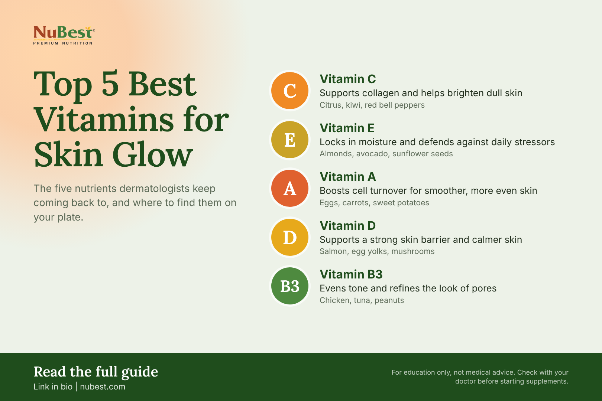

# Skin-Vitamin Meal Checker

A small, dependency-free JavaScript tool that shows which of five skin-supporting vitamins your meal covers, and suggests foods for any that are missing.

**Live demo:** https://nubestimmunegummies.github.io/skin-vitamin-meal-checker/



## What it does

Tick the foods on your plate. The checker:

- Counts how many of vitamins C, E, A, D, and B3 you've covered
- Shows what each vitamin does for skin, color-coded when covered
- Suggests up to three foods for each missing vitamin, skipping anything already selected

Example: selecting **Orange** and **Eggs** gives

```
3 of 5 vitamins covered
Need vitamin E? Try Almonds, Avocado, Spinach.
Need vitamin B3? Try Salmon, UV-exposed mushrooms, Chicken.
```

## Data

| Vitamin | Role shown in the tool | Example foods |
|---|---|---|
| C | Supports natural collagen production | Orange, kiwi, red bell pepper |
| E | Helps skin hold onto moisture | Almonds, avocado, spinach |
| A | Plays a part in natural skin cell renewal | Carrots, sweet potato, eggs |
| D | Studied for its role in the skin barrier | Salmon, eggs, UV-exposed mushrooms |
| B3 | Researched for supporting ceramides | Chicken, salmon, peanuts |

Both `VITAMINS` and `FOODS` are plain objects at the top of the `<script>` in `index.html`, so you can add foods or vitamins without touching the logic.

## How it works

1. **Data as arrays of objects.** Each food lists the vitamins it provides, so one food can cover several.
2. **`Set` for lookups and deduplication.** `checkMeal()` turns the selection into a `Set`, uses `flatMap` to collect vitamins, and wraps the result in another `Set` to drop duplicates.
3. **Chained array methods.** `suggestFoods()` filters, slices, and maps to return up to three suggestions per missing vitamin.
4. **Event delegation.** One `change` listener on the `fieldset` handles every checkbox.
5. **Safe rendering.** Output is built with `createElement` and `textContent`, and cleared with `replaceChildren()`, never `innerHTML`.

## Run locally

No build step. Clone the repo and open `index.html` in a browser:

```bash
git clone https://github.com/nubestimmunegummies/skin-vitamin-meal-checker.git
cd skin-vitamin-meal-checker
open index.html        # macOS; on Windows use: start index.html
```

## Project structure

```
skin-vitamin-meal-checker/
├── index.html      # Layout, data, and logic
├── style.css       # Styles (light and dark mode)
├── README.md
└── assets/
    └── top-5-vitamins-skin-glow-ig-3x2.png   # README and social preview image
```

## Background

The vitamin list and food sources are based on [Top 5 Best Vitamins for Skin Glow](https://www.nubest.com/blogs/beauty-care/best-vitamins-for-skin) in the NuBest Health Library. Nutrition guidance changes over time, so review the data against current sources before relying on it.

## Disclosure

The author works with NuBest Nutrition, whose article is cited as background for the data. This project is a coding demo. It is not medical or nutrition advice.
